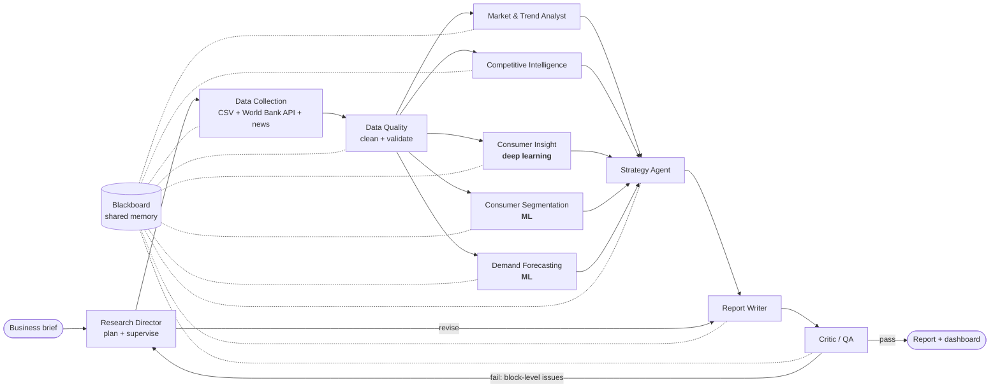

# MarketMind - a multi-agent market research system

[](https://github.com/zidanarsyad/marketmind/actions/workflows/tests.yml)

MarketMind runs a complete market research study end to end: a **Research Director** agent turns a business brief into a research plan, specialist agents collect and clean data, analyse the market, competitors and consumers (with **deep learning** and **machine learning**), forecast demand, build a strategy, write the report, and a **Critic** agent fact-checks every number before the report is released. Everything is visible in an interactive **Streamlit dashboard**.

The demo scenario is the **Indonesian local facial-skincare market** (Jan 2023 - Oct 2026). The client is *Kirana Beauty*, a fictional local brand competing with five other fictional brands. All datasets are simulated but realistic (Indonesian marketplace reviews with slang and emojis, Ramadan seasonality, TikTok Shop's rise, survey data-quality problems), and macro data comes live from the **World Bank API**.

| | |
|---|---|
| **Agents** | 11 cooperating agents + an on-demand Analyst Chat agent |
| **Deep learning** | PyTorch BiGRU-with-attention sentiment model (vs. TF-IDF baseline + ensemble), transferred to unlabeled social posts |
| **Machine learning** | K-Means segmentation, gradient-boosting demand forecasting, NMF topic mining, Poisson anomaly detection, fixed-effects price elasticity |
| **LLM** | Optional - free Gemini / Groq / OpenRouter / local Ollama, or Claude. Fully functional offline. |
| **Quality gate** | Critic agent verifies numeric grounding, coverage, citations and evidence; failed reports go back for revision |
| **Human in the loop** | Approval gates on the research plan and the recommendations (terminal: `run.py --approve`, or the dashboard); without a reviewer they approve automatically and the report says so |
| **Real-data ready** | `scripts/import_tokopedia.py` turns the Tokopedia 2025 review dataset into MarketMind's formats; `run.py --data-dir` studies it, running the modules the data supports and disclosing the source and its caveats |
| **Adaptive and bounded** | The Research Director sends analysts back for questions the report leaves open; every agent is retried once and has a time limit; each run has an LLM budget |
| **Effectiveness** | 24 / 25 planted ground-truth insights recovered on the reference data; 23.6 / 25 on average over five more data seeds (see [Evaluation](#evaluation)) |

---

## Quick start

```bash
git clone https://github.com/zidanarsyad/marketmind.git
```

```bash
pip install -r requirements.txt
```

```bash
python run.py
```

```bash
streamlit run app/dashboard.py
```

The simulated datasets are in the repository (`python scripts/generate_data.py` regenerates them identically). `run.py` prints the live agent trace and saves everything to `outputs/runs/<run_id>/` (report.html, report.md, findings, tables, trace). The first run trains the deep-learning model (3-4 minutes on a laptop CPU); later runs reuse it (1-2 minutes). Add `--approve` to review the research plan and the recommendations yourself before the study goes on. In the dashboard you can also launch new studies with your own brief, watch the agents work live, and approve the plan and recommendations in a form. For the exact package versions the tests last passed with, install `requirements-lock.txt` instead.

Optional: copy `.env.example` to `.env` and add **one free API key** to switch on LLM planning, narrative and chat (see [LLM setup](#llm-setup)). Check the code with `python -m ruff check .` and run the tests with `python -m pytest -q`, or just the fast ones with `python -m pytest -q -m "not slow"`. The tests cover each agent's core logic, end-to-end runs, the Critic's revision loop, the approval gates, retries, time limits and the Director's follow-ups, the schema contracts, failure paths and the dashboard. GitHub Actions runs the linter and the tests, with coverage, on every push.

---

## Documentation

| Document | Contents |
|---|---|
| [User guide](docs/USER_GUIDE.md) | Installing, running studies, writing briefs, the dashboard, reading the report, LLM setup, troubleshooting |
| [Architecture](docs/ARCHITECTURE.md) | Context, components, classes, workflow, run sequence, lifecycles, data flow, deployment, model architectures, design decisions |
| [Agent specifications](docs/AGENTS.md) | For every agent: PEAS profile, tools, inputs and outputs, findings, LLM use and failure behaviour; plus the finding registry |
| [Data contracts](docs/SCHEMAS.md) | JSON Schemas for every artefact and message, the blackboard key registry, dataset row contracts, the SQL model |
| [Data dictionary](docs/DATA_DICTIONARY.md) | Every column of the seven datasets |
| [Real data sources](docs/DATA_SOURCES.md) | Public datasets and statistics to replace, validate or calibrate the simulated data, with licences |
| [Evaluation report](docs/EVALUATION.md) | Ground-truth checks, model metrics, data quality, governance, timings, threats to validity |
| [Developer guide](docs/DEVELOPER_GUIDE.md) | Core APIs, adding agents, tools, charts, datasets and LLM providers, testing and debugging |
| [Diagram gallery](docs/diagrams/gallery.html) | All 14 diagrams on one page, with SVG and PNG export |

The design proposal is a separate Claude Doc. Four scripts support the documents and the real-data work:

```bash
python scripts/export_sqlite.py
```

```bash
python scripts/build_diagram_gallery.py
```

```bash
python scripts/validate_on_real_data.py
```

```bash
python scripts/import_tokopedia.py path/to/archive.zip
```

The first loads the clean datasets and the latest run into `outputs/marketmind.db`, following `docs/schemas/database.sql`. The second rebuilds the diagram gallery from the Mermaid blocks in the docs. The third scores the sentiment models on real Indonesian reviews downloaded into `data/external/` (see section 4.6 of the evaluation report). The fourth imports the Tokopedia 2025 dataset (downloaded from Kaggle) as a real-data folder, which `python run.py --data-dir data/real/tokopedia-2025` then studies ([docs/DATA_SOURCES.md](docs/DATA_SOURCES.md), section 8).

---

## Architecture



**How the agents cooperate**

- **Blackboard architecture** (`marketmind/core/blackboard.py`): agents never call each other. They read inputs from a shared, thread-safe blackboard, write artefacts back with provenance, publish structured `Finding` objects (statement + metrics + evidence + impact + confidence + SWOT hint) and leave messages for one another.
- **Perceive - reason - act - publish loop** (`core/agent.py`): every agent registers *tools* and calls them through `use()`, so each thought, tool call, observation and finding is traced (`core/events.py`) and replayable in the dashboard.
- **DAG orchestration with parallelism** (`core/orchestrator.py`): the Director builds the workflow from the plan; the five analysis agents run concurrently on a thread pool. If an analysis agent fails, the rest of the study still completes (graceful degradation).
- **Reflection loop**: the Critic scores the report (structure, question coverage, numeric grounding, citations, evidence, disclosure). Below 85/100 or any critical issue, the Director sends block-level feedback to the Report Writer, which replaces the rejected blocks with grounded text - up to two revisions.
- **Grounding by design**: numbers are produced only by deterministic tools; the LLM (when present) only writes language, and the Critic checks every number in LLM prose against the evidence.
- **Persistence**: every run is saved (`core/store.py`) and can be reloaded, compared and evaluated later.

### The agents

| Agent | Role | Key methods / tools | Main outputs |
|---|---|---|---|
| Research Director | Orchestrator & planner | brief parsing (rules + optional LLM), workflow building, QA supervision | research plan, questions, revision requests |
| Data Collection | Data engineer | 7 internal datasets, **World Bank API** (8 indicators, cached), optional GNews/NewsAPI | data catalogue, macro table |
| Data Quality | Data steward | label standardisation, duplicates, robust outliers, imputation, survey screening (speeders, straight-liners, attention checks) | clean data, scorecard, caveats |
| Market & Trend Analyst | Market analyst | market sizing & CAGR, growth decomposition, seasonality (Ramadan, 11.11/12.12), topic share-of-voice momentum | 6 market findings |
| Competitive Intelligence | Competitive analyst | share & momentum, channel/region over-indexing, price-value map, share of voice, multi-factor threat index, white-space scan, stock-out losses | 9 competition findings |
| **Consumer Insight (DL)** | NLP specialist | BiGRU-attention + TF-IDF/LogReg + ensemble, aspect-based sentiment, Poisson complaint-spike detection, NMF topics, social transfer | sentiment, pain points, crises |
| **Consumer Segmentation (ML)** | Quant researcher | K-Means (k by silhouette), PCA, persona naming, concept test, **Van Westendorp** | segments, target, launch price |
| **Demand Forecasting (ML)** | Forecasting economist | global direct multi-horizon gradient boosting, rolling-origin backtest, intervals, FE log-log **price elasticity** | 12-month outlook, scenarios |
| Strategy | Strategy consultant | finding ranking, SWOT, opportunity sizing, evidence-linked recommendation playbook | SWOT, 8 recommendations, KPIs |
| Report Writer | Research writer | Markdown + self-contained interactive HTML (offline Plotly) | `report.md`, `report.html` |
| Critic (QA) | Reviewer | numeric grounding, coverage, citation & evidence checks | QA verdict, revision issues |
| Analyst Chat | Analyst on call | retrieval over findings with intent boosts (+ LLM when available) | grounded answers with citations |

---

## Machine learning and deep learning

**Consumer Insight Agent (deep learning).** Labels come from star ratings (1-2 negative, 3 neutral, 4-5 positive). Three candidates are trained on about 13.6k reviews: a TF-IDF (word + char n-grams) logistic regression, a **bidirectional GRU with additive attention** (PyTorch, length-bucketed batches, word dropout, early stopping on validation macro-F1) and a soft-vote ensemble. Validation picks the winner and a held-out test set reports honest metrics (macro-F1 about 0.82, accuracy about 0.90). The model is then applied where no labels exist:
- *Aspect-based sentiment*: reviews are split into clauses, aspects detected with an Indonesian lexicon (effectiveness, texture, scent, packaging, price, delivery, skin reaction, authenticity, stock), and each clause scored by the model.
- *Social listening*: the review-trained model scores unlabeled TikTok/Instagram/X/YouTube posts. A 400-post hand-labelled sample is used to choose the most robust scorer for this domain shift (the ensemble wins: macro-F1 about 0.92 versus 0.85 for the BiGRU alone).
- *Early warning*: monthly complaint rates per brand x aspect are tested against a rolling baseline with a Poisson test; flagged episodes are ranked by excess complaints.

The dashboard includes a **live tester**: type any review and see the prediction, the attention weights and the aspect-level sentiment.

**Real reviews.** By default the sentiment models learn from the study's own reviews, which are simulated in the bundled data. Models trained only on simulated text do not read real reviews well. With `python run.py --sentiment-data study+real`, the models also learn from about 72,000 real Shopee/Tokopedia beauty reviews (`real` uses only those). Download them first; see [docs/DATA_SOURCES.md](docs/DATA_SOURCES.md) and section 4.6 of the [evaluation report](docs/EVALUATION.md).

**Consumer Segmentation Agent (machine learning).** K-Means on 16 standardised attitude and behaviour variables; k = 3..8 compared with silhouette, Calinski-Harabasz and Davies-Bouldin; PCA for visualisation; segments named automatically from their most distinctive drivers. The concept test picks the primary target (highest purchase intent among segments with at least 10% of consumers), and the **Van Westendorp price sensitivity meter** gives the acceptable range and the optimal price zone.

**Demand Forecasting Agent (machine learning).** One global `HistGradientBoostingRegressor` across 150 brand x category x channel series, predicting year-over-year log growth as a residual over recent momentum (so the trees can extrapolate growth), with direct multi-horizon training (h = 1..12). Exogenous drivers: the moving Ramadan/Eid calendar, list-price and promo changes, stock-outs. Four candidates (GBM, seasonal naive, seasonal naive with drift, GBM + drift ensemble) are compared with **three rolling-origin backtests**; the winner forecasts 12 months ahead with error-based 80% intervals. Price elasticities come from a fixed-effects log-log demand model (series FE, month x channel-type FE, brand trends, stock-out control, robust SEs).

---

## Data

Generated by `scripts/generate_data.py` (seeded, reproducible) into `data/raw/`. See [docs/DATA_DICTIONARY.md](docs/DATA_DICTIONARY.md) for every column.

| Dataset | Rows | What it is |
|---|---|---|
| `market_sales_panel.csv` | ~48k | Monthly sell-out by brand x category x channel x region, with list price, discount, stock-out days |
| `product_reviews.csv` | ~20k | Indonesian marketplace reviews (slang, emojis, typos, code-mixing) with star ratings |
| `social_mentions.csv` | ~11k | Social posts with platform, topics, engagement, influencer tier (unlabeled) |
| `consumer_survey.csv` | 2,400 | Usage & attitude survey, concept test, Van Westendorp price questions, quality-check fields |
| `product_catalog.csv` | 49 | SKUs with price, size, key ingredient, fragrance-free flag, rating |
| `market_size.csv` | 40 | Market size by category, 2019-2026E |
| `social_validation_labels.csv` | 400 | Hand-labelled social posts for validating model transfer |

Realism built in: Ramadan/Eid and 11.11/12.12 seasonality, TikTok Shop's rise, a price increase with an elastic response, a packaging defect, a competitor's counterfeit crisis, regional growth outside Java, emerging ingredient trends, and real-world data defects (duplicates, label variants, negative and outlier sales, missing values, survey speeders and straight-liners). Every planted effect is recorded in `data/ground_truth.json`.

---

## LLM setup

The system is complete without an LLM. With one, the Director refines the plan, the Strategy agent and Report Writer add narrative, the Segmentation agent names personas, and the Analyst Chat answers in natural language. Copy `.env.example` to `.env` and set **one** of:

| Provider | Free? | Variable | Get a key |
|---|---|---|---|
| Google Gemini | free tier | `GEMINI_API_KEY` | https://aistudio.google.com/apikey |
| Groq (Llama / Qwen) | free tier | `GROQ_API_KEY` | https://console.groq.com/keys |
| OpenRouter `:free` models | free | `OPENROUTER_API_KEY` | https://openrouter.ai/keys |
| Ollama (local) | free, offline | `LLM_PROVIDER=ollama` | https://ollama.com |
| Claude (official Anthropic SDK) | paid | `ANTHROPIC_API_KEY` | https://console.anthropic.com |

`LLM_PROVIDER=auto` picks the first key found, in the order Groq, Gemini, OpenRouter, Claude (Groq first because it was the fastest in the real-LLM runs, with every number grounded). `<PROVIDER>_MODEL` and `<PROVIDER>_FALLBACK_MODEL` (for example `GROQ_MODEL`) choose the models. Responses are cached, free-tier rate limits are respected, a busy or hung model hands the call to the fallback, retired model names are replaced automatically, and any failure falls back to deterministic reasoning. For Claude the client uses `claude-opus-5-5` with server-side refusal fallbacks enabled. Test the connection from the dashboard sidebar.

---

## Dashboard

`streamlit run app/dashboard.py` - tabs: **Overview** (KPIs, key findings, priority actions) · **Agents** (workflow graph, roster, messages, approvals and follow-ups, full trace explorer) · **Market** · **Competition** · **Consumers (DL)** (model card, confusion matrix, aspect heatmap, complaint spikes, live model tester) · **Segments** (PCA small multiples, personas, concept test, Van Westendorp) · **Forecast & pricing** (forecasts with intervals, backtest, drivers, elasticities, price simulator) · **Strategy** (SWOT, recommendations, sized opportunities) · **Report** (embedded HTML + downloads) · **Ask the analyst** (chat) · **Evaluation** (ground-truth scorecard) · **Data**.

---

## Evaluation

Because the data is simulated, the true market facts are known, so the whole multi-agent system can be scored objectively:

```bash
python scripts/evaluate_agents.py
```

Reference run: **24 / 25 checks passed**. These cover the fastest-growing category, channel and regions; rising and declining topics; the client's under-indexed channel; the top threat; the white space; the client's main pain point and its timing; the competitor's counterfeit crisis; the price-increase backlash; the number of segments (ARI 0.985 against true segments); the concept target and price band; the client price elasticity (estimated -1.29 vs true -1.30); sentiment quality, social transfer accuracy (0.94 on about 11k posts with hidden labels) and aspect detection (precision 0.91, polarity accuracy 0.99); forecast versus naive benchmark (WAPE 13.5% vs 17.5%); data-defect detection; and the QA gate. The miss is the concept price: Rp 79,900 against a true band of Rp 80,000-100,000. The optimal price point rests on just 3 and 1 survey answers near it, so a respondent or two decide between two charm prices; the agent reports the pick as not settled and recommends testing both.

Beyond one run: `scripts/multi_seed.py` regenerates the market with five more seeds. The system averages 23.6 / 25 there, and 21 of the checks pass in every dataset; the misses are effects planted close to the noise level. `scripts/ablations.py` measures what each design choice buys, and `scripts/llm_runs.py` runs the study with real LLMs and records what the Critic catches ([docs/EVALUATION.md](docs/EVALUATION.md), sections 7-9).

---

## Project structure

```
marketmind/
  core/        agent base class, blackboard, tracer, LLM client, workflow engine, run store
  agents/      the 11 pipeline agents + analyst chat
  ml/          text normalisation, sentiment (PyTorch), topics, segmentation, forecasting, pricing, calendar
  reporting/   shared Plotly chart library + HTML report renderer
  evaluation.py  ground-truth scoring
  sql_export.py  loads clean data and runs into the SQL model
  system.py    MarketResearchSystem entry point
app/dashboard.py     Streamlit dashboard
scripts/             generate_data.py, evaluate_agents.py, export_sqlite.py, build_diagram_gallery.py, validate_on_real_data.py,
                     multi_seed.py, ablations.py, llm_runs.py (evaluation studies), import_tokopedia.py (real data)
docs/                guides, architecture, agent specs, evaluation; schemas/ (JSON Schema + SQL); diagrams/
data/raw/            datasets            data/ground_truth*  hidden labels for evaluation
outputs/runs/        one folder per run  outputs/models/     cached deep-learning model
tests/               unit, end-to-end, QA-loop (fake LLM) and schema-contract tests
```

**Extending.** New agent: subclass `BaseAgent`, register tools in `register_tools()`, publish `Finding`s in `execute()`, and add a `Task` in `ResearchDirectorAgent.build_workflow()`. Own data: replace the CSVs in `data/raw/` keeping the column names in the data dictionary; the brief and client brand are free inputs.

## Limitations

- The bundled data is simulated. Real review data can be imported (Tokopedia 2025), but no open source offers a sales panel or survey, so a real-data study runs the consumer module only.
- Forecasts assume current list prices and last year's promotional calendar; shocks such as the counterfeit crisis are not predictable.
- Concept revenue uses an explicit 5% conversion assumption; aspect detection is lexicon-based.
- Only the market-size table spans 2019-2026; panel shares are shares of the six tracked brands.
