# MarketMind architecture

MarketMind is a cooperative multi-agent system: a goal-based **Research Director** plans a study from a free-text brief and supervises ten specialist agents that communicate only through a shared **blackboard**. Numbers come from deterministic tools and ML/DL models; an optional LLM supplies language; a **Critic** agent verifies every number before a report is released.

This document describes the system as built. Every diagram is Mermaid (renders on GitHub, in VS Code and in `docs/diagrams/gallery.html`, which also exports SVG/PNG). Related documents: [AGENTS.md](AGENTS.md) (per-agent specifications), [SCHEMAS.md](SCHEMAS.md) (data contracts), [DATA_DICTIONARY.md](DATA_DICTIONARY.md), [EVALUATION.md](EVALUATION.md).

---

## 1. System context

Who and what MarketMind talks to. Everything outside the box is optional except the data files.

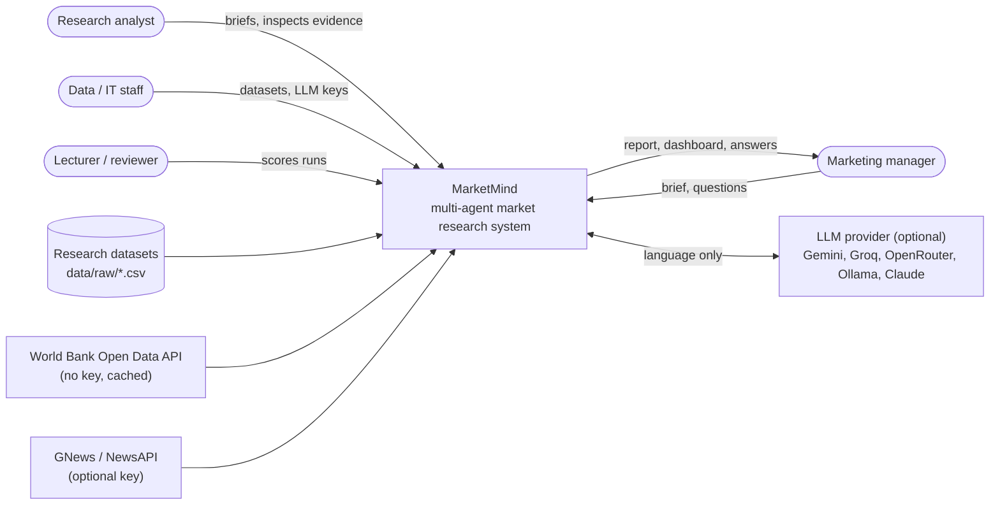

## 2. Components (layered view)

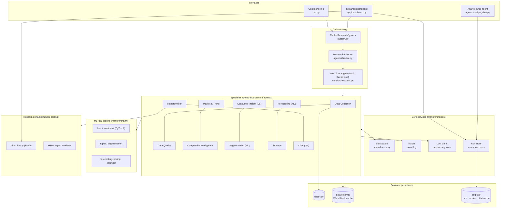

| Package / module | Responsibility |
|---|---|
| `marketmind/core/agent.py` | `BaseAgent` (tools, tracing, findings, LLM helper, lifecycle), `RunContext`, `AgentResult` |
| `marketmind/core/blackboard.py` | Thread-safe shared memory: artefacts with provenance, findings, agent-to-agent messages |
| `marketmind/core/events.py` | `Tracer` / `Event`: every status, thought, tool call, observation, finding, message, LLM call, warning, error |
| `marketmind/core/findings.py` | `Finding`, the unit of knowledge (statement + metrics + evidence + impact + confidence + SWOT) |
| `marketmind/core/llm.py` | Provider-agnostic LLM client: caching, throttling, model rediscovery, JSON parsing, graceful failure |
| `marketmind/core/orchestrator.py` | `Workflow` / `Task`: topological layers, parallel execution, critical vs non-critical tasks |
| `marketmind/core/store.py` | Run persistence (`save_run`, `RunData`, `list_runs`, `load_run`) |
| `marketmind/agents/` | The eleven pipeline agents and the Analyst Chat agent |
| `marketmind/ml/` | Text normalisation, sentiment models, topics, segmentation, forecasting, pricing, Indonesian calendar |
| `marketmind/reporting/` | Shared Plotly chart library (`CHARTS` registry) and the self-contained HTML report |
| `marketmind/system.py` | `MarketResearchSystem`: wires context, runs Director + workflow + QA loop, saves the run |
| `marketmind/evaluation.py` | Scores a run against the planted ground truth |
| `marketmind/sql_export.py` | Loads clean datasets and runs into the SQL model (`docs/schemas/database.sql`) |
| `app/dashboard.py` | Streamlit dashboard (12 views, live runs, chat, evaluation) |

## 3. Core classes

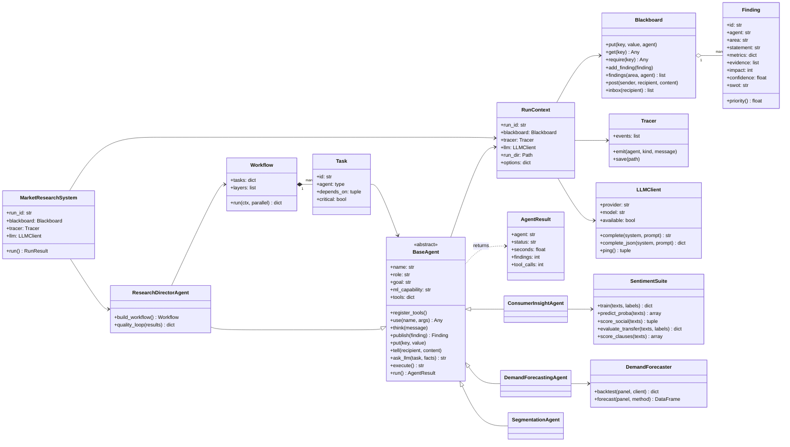

The other seven agents (Data Collection, Data Quality, Market & Trend Analyst, Competitive Intelligence, Strategy, Report Writer, Critic) also subclass `BaseAgent`; they are omitted from the diagram for readability.

## 4. Workflow (dependency graph)

The Director builds this graph from the plan's active modules. Data tasks are **critical** (a failure skips dependents); analysis tasks are **non-critical** (a failure leaves Strategy to work with the findings that exist).

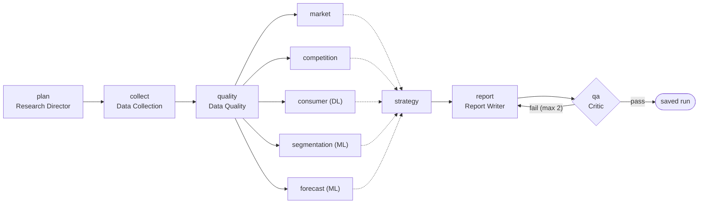

Dotted edges = non-critical dependencies. Analysis agents run concurrently on a `ThreadPoolExecutor` with three workers.

## 5. A run, step by step

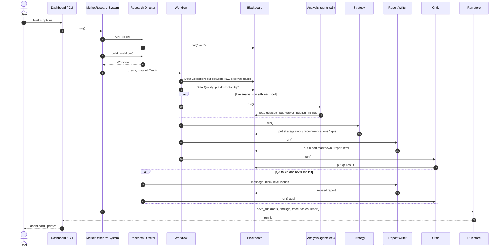

## 6. Lifecycles

**Agent lifecycle.** Every agent goes through the same loop; each transition is a traced event.

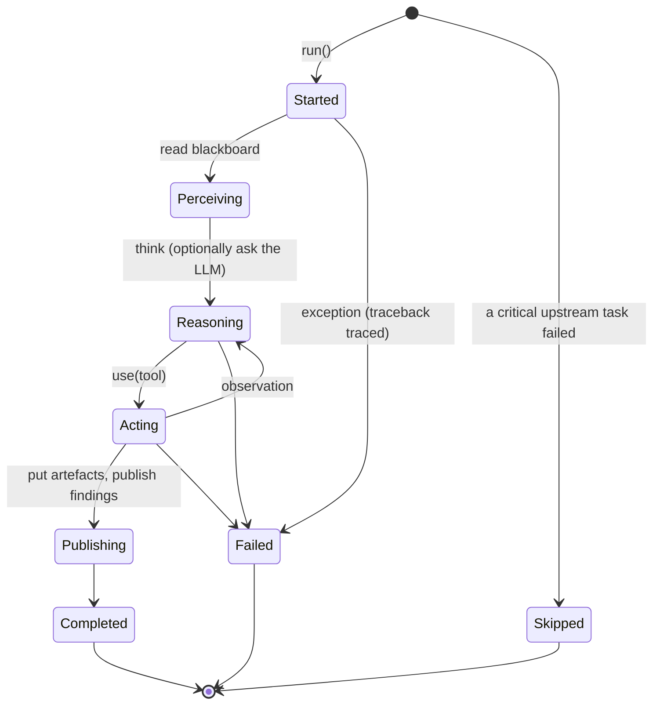

**Run lifecycle and the QA gate.**

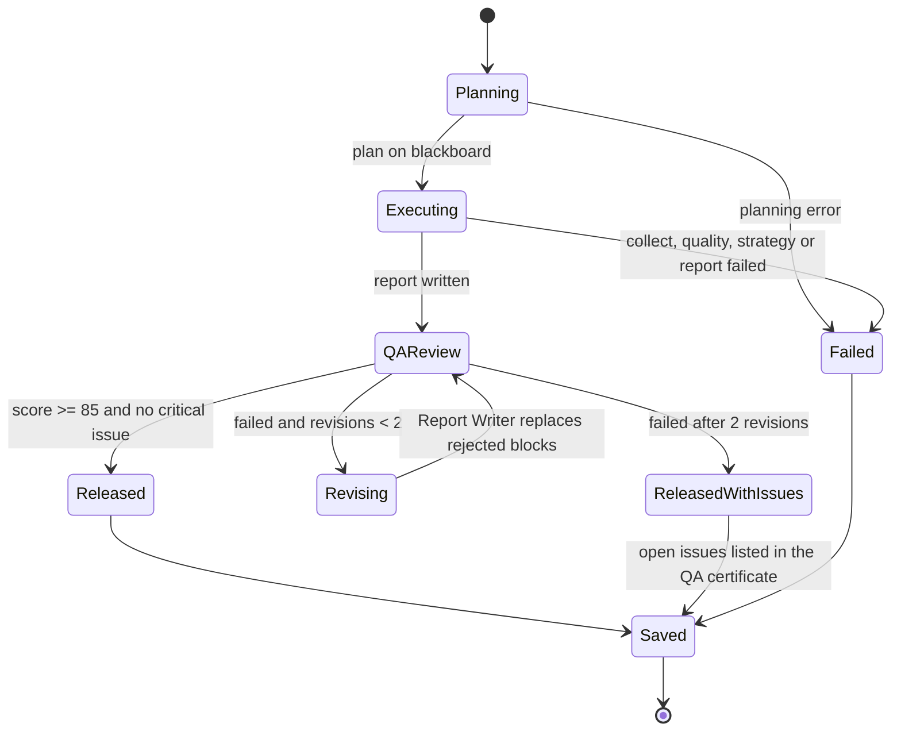

## 7. Data flow

Level-1 data-flow diagram: processes (circles), data stores (cylinders), external entities (rectangles).

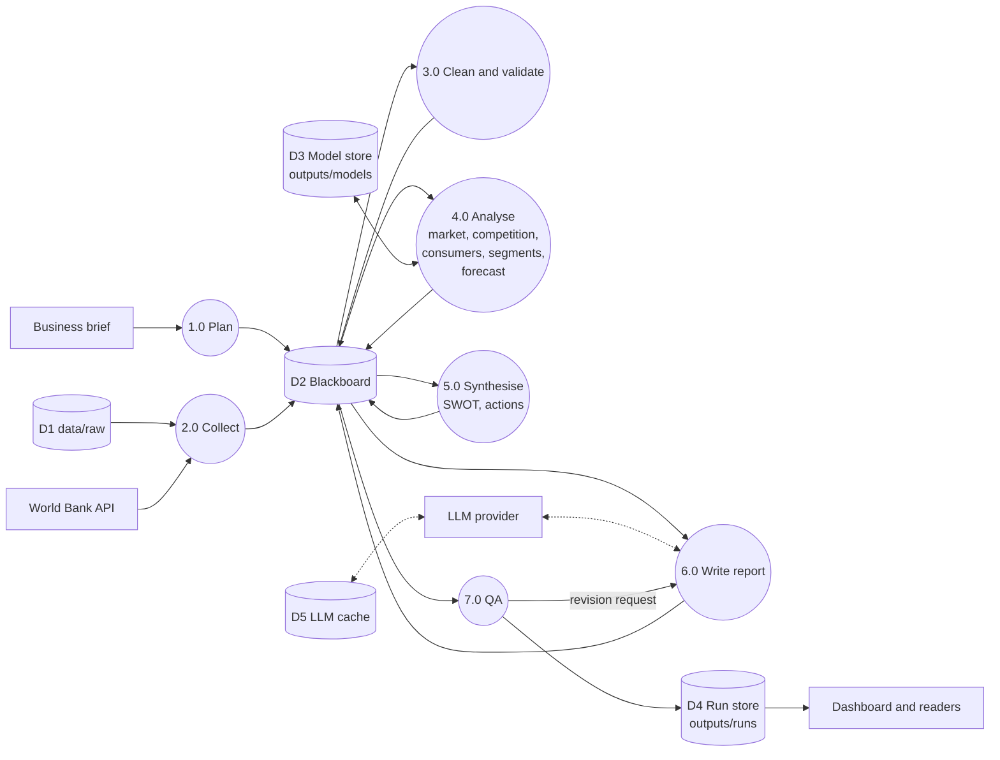

## 8. Deployment

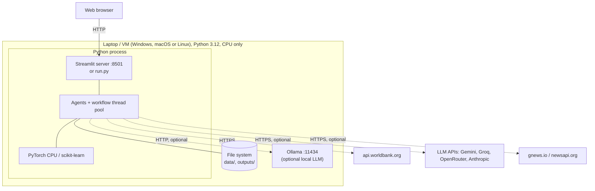

Enterprise path: containerise the process, schedule studies (cron or a workflow orchestrator), load datasets from a warehouse with `docs/schemas/database.sql`, put the dashboard behind single sign-on, keep keys in a secrets manager.

## 9. Model architectures

**Deep-learning sentiment model** (Consumer Insight agent):

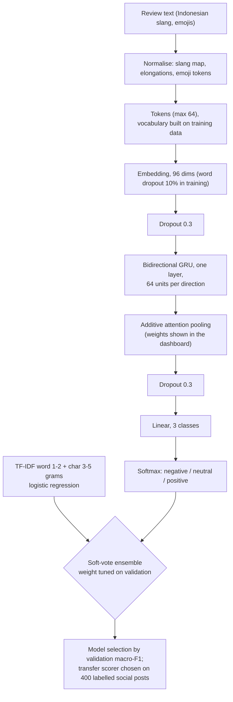

**Demand forecaster** (Demand Forecasting agent):

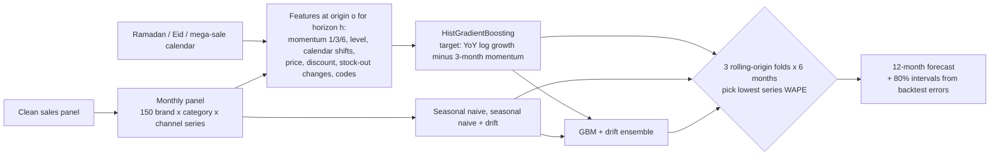

**Critic numeric-grounding check:**

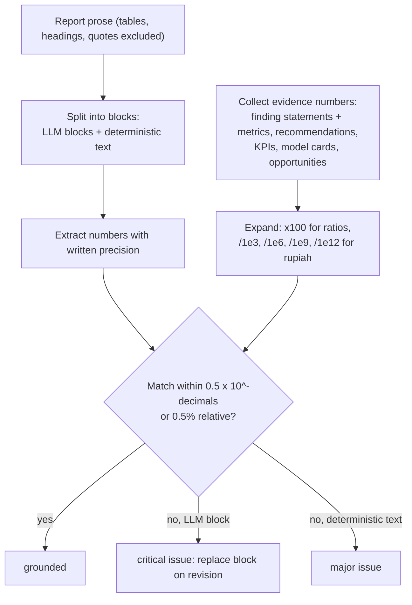

## 10. Key design decisions

| Decision | Alternatives considered | Why |
|---|---|---|
| Custom lightweight agent framework | LangGraph, CrewAI, AutoGen | Works fully offline, no LLM required for control flow, every step is inspectable for teaching and audit |
| Blackboard communication | Direct agent calls, message bus | Decouples agents, gives one place for provenance, makes parallel execution and persistence simple |
| Deterministic tools produce all numbers; LLM writes language only | LLM-driven analysis (ReAct over pandas) | Prevents hallucinated figures; the Critic can verify every number |
| Critic + bounded revision loop | Single-pass generation | Reflection catches ungrounded LLM text without unbounded loops (max 2 revisions) |
| Model selection by validation, honest test metrics | Fixed model choice | The DL model must earn its place; the ensemble or baseline wins when it is better |
| Transfer validation on a labelled social sample | Assume review-trained model transfers | An early BiGRU labelled 73% of social posts negative. The check now picks the best scorer for that domain: the ensemble reaches macro-F1 0.918 on the labelled posts, against 0.850 for the BiGRU alone |
| Direct multi-horizon residual boosting + rolling backtests | Recursive forecasting, single holdout | Recursive feedback inflated forecasts; one holdout was dominated by an unforecastable shock |
| Simulated data with recorded ground truth | Real scraped data only | Lets the whole system be scored objectively; documented schemas allow swapping in real data |
| Files for persistence, SQL model for export | Database as the primary store | Zero-setup for students; `scripts/export_sqlite.py` gives the relational view when needed |

## 11. Cross-cutting concerns

- **Concurrency:** the blackboard and tracer use locks; analysis agents share a three-worker pool; PyTorch uses up to four threads.
- **Error handling:** `BaseAgent.run()` catches exceptions, traces the traceback and returns a `failed` result; the workflow skips only critical dependents; the dashboard guards each view.
- **Caching:** the sentiment models are cached under a hash of their training data, in one folder per training mode (`--sentiment-data`); World Bank responses are cached in `data/external`; LLM responses are cached in `outputs/cache/llm`.
- **Configuration:** `.env` (LLM provider and keys, news keys, rate limit), `marketmind/config.py` (paths, dataset registry, default brief).
- **Security:** API keys travel only in request headers, never in prompts, traces, run files or reports. Streamlit listens on all network interfaces by default; set `address = "localhost"` under `[server]` in `.streamlit/config.toml` to keep the dashboard private to one machine.
- **Performance:** about 2 minutes for a first run (model training) and about 50 seconds once the models are cached (48 s for the reference run, on an 8-thread laptop CPU).
