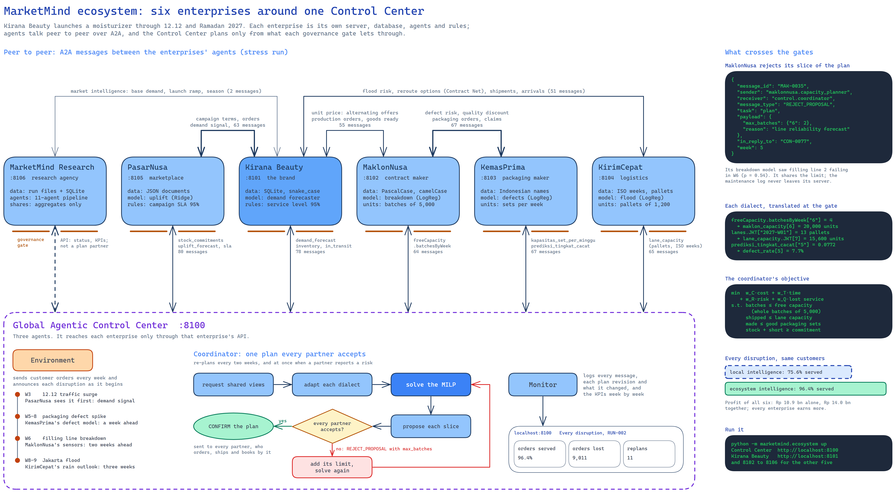
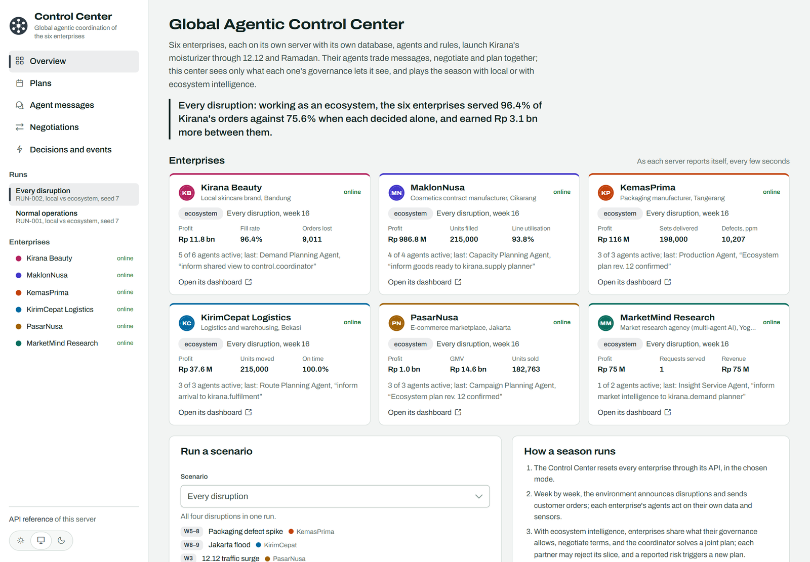
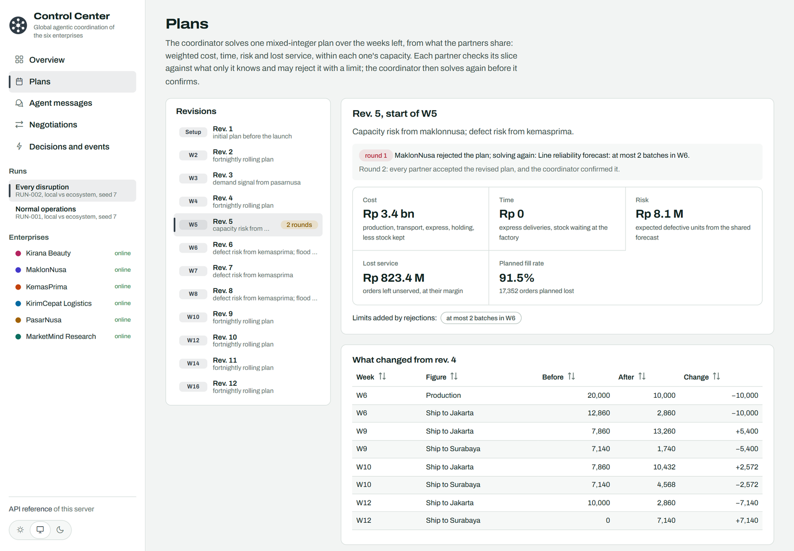
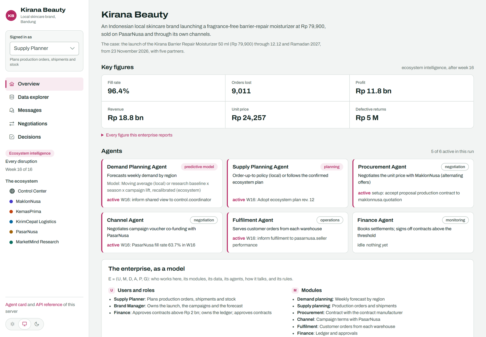

# MarketMind ecosystem: six enterprises, one Control Center

MarketMind's research system answers one company's question. The ecosystem (`marketmind/ecosystem/`) puts that answer to work across six independent enterprises: a skincare brand, its contract manufacturer, its packaging maker, its logistics company, the marketplace it sells on, and the research agency. Each enterprise is its own server with its own database, agents, roles and rules. Their agents talk to each other in one message contract, negotiate terms, and plan the season together under a Global Agentic Control Center that sees only what each enterprise agrees to share. The same season can be played with **local intelligence** (each enterprise decides alone, on its own data) or **ecosystem intelligence** (the enterprises share, negotiate and plan together), on the same customers, so the difference can be measured.



*The editable diagram is [diagrams/ecosystem-architecture.excalidraw](diagrams/ecosystem-architecture.excalidraw) (excalidraw.com or the VS Code extension).*

```bash
python -m marketmind.ecosystem run
```

```bash
python -m marketmind.ecosystem up
```

`run` plays every scenario in both modes in one process (about a second a season) and prints the comparison; `--scenario stress --json outputs/ecosystem/stress.json` writes everything, every message included. `up` starts seven servers, each in its own process with its own database under `outputs/ecosystem/`, waits until all answer, plays a first comparison, and prints the addresses: the Control Center at <http://localhost:8100>, Kirana Beauty at <http://localhost:8101>, MaklonNusa 8102, KemasPrima 8103, KirimCepat 8104, PasarNusa 8105 and MarketMind Research 8106. Each address opens that node's own dashboard, so each enterprise can sit in a different browser. The web app must be built once (`npm --prefix frontend run build`); `python -m marketmind.ecosystem serve kirana --port 8101` starts one node alone.

---

## 1. The business problem

Kirana Beauty, the client of MarketMind's study, launches the product the study recommended: a fragrance-free barrier-repair moisturizer (SKU `KB-BRM-50`) at Rp 79,900. The season runs 16 weeks from Monday 23 November 2026 through two demand peaks: PasarNusa's **12.12 Mega Sale** in week 3, and its **Ramadan Ekstra** campaign in weeks 12 to 15 (Ramadan 2027 runs 8 February to 9 March, Eid on 10 March).

No enterprise can launch it alone. Kirana owns the demand but not the factory; MaklonNusa fills it in batches of 5,000 on two lines it shares with other brands; KemasPrima moulds the pump packaging; KirimCepat moves it from Cikarang to the Jakarta and Surabaya warehouses; PasarNusa brings three quarters of the customers and runs the campaigns; MarketMind Research knows the market. Four things can go wrong, and each is first visible to a different enterprise: a packaging defect spike (KemasPrima's QC), a breakdown of filling line 2 (MaklonNusa's sensors), a flood on the Jakarta lane (KirimCepat's weather outlook), and 12.12 traffic far above any forecast (PasarNusa's live traffic).

The shared problem is to **serve as many of Kirana's customers as possible, profitably for every enterprise**, while each keeps its own data and interests. The measures are Kirana's fill rate (orders served over orders received), orders lost, stock-out weeks, defective returns, the profit of each enterprise, and their total.

## 2. Local intelligence and ecosystem intelligence

| | Local intelligence | Ecosystem intelligence |
|---|---|---|
| What an enterprise shares | Only its public keys: a price list, a rate card, the campaign calendar | Its public keys, plus the keys its governance shares with partners and with the Control Center |
| Kirana's forecast | Moving average of the orders it has seen, plus a rule-of-thumb 30% lift on the marketplace share in campaign weeks | MarketMind's demand baseline × launch ramp × Ramadan season × PasarNusa's lift forecast, recalibrated every week on the orders it sees |
| Terms | List prices and standard terms: Rp 25,000 a unit, 60% of the campaign voucher | Negotiated: unit price, voucher share, quality compensation, a flood reroute |
| Production and shipping | Kirana orders up to three weeks of its own forecast, ships 65/35 to Jakarta and Surabaya | Everyone follows one plan the Coordinator solved and every partner accepted |
| A risk one enterprise sees | Stays with it (it may protect itself) | Is reported to the partners concerned and to the Coordinator, which plans again |

The same random draws drive both modes: the same customers, the same disruptions in the same weeks, the same sensor noise.

## 3. The six enterprises

Each enterprise is a model E<sub>i</sub> = (U<sub>i</sub>, M<sub>i</sub>, D<sub>i</sub>, A<sub>i</sub>, P<sub>i</sub>, G<sub>i</sub>): users and roles, modules, local data, agents, protocol and API, governance. Every server publishes its own model in its Agent Card (`x-enterprise`) and on its dashboard's overview.

| Enterprise (port) | U: roles | M: modules | D: local data | A: agents (predictive model) | G: shares with partners / with the Control Center; never shares |
|---|---|---|---|---|---|
| **Kirana Beauty** (8101), brand, Bandung | Supply Planner, Brand Manager, Finance (approves contracts above Rp 2 bn) | Demand planning, supply planning, procurement, channels, fulfilment, finance | SQLite, snake_case: `forecasts`, `inventory`, `fulfilment`, `campaigns`, `contracts`, `ledger`, `product` | Demand Planning (forecaster), Supply Planning, Procurement, Channel, Fulfilment, Finance | `demand_forecast`, `commitments` / plus `inventory`, `in_transit`, `factory_stock`, `locked_production`, `unit_price`, `margin_per_unit`, `reroute`; never `ledger`, `contracts` |
| **MaklonNusa** (8102), contract manufacturer, Cikarang | Production Manager, Maintenance Engineer, Sales | Capacity planning, line reliability, quotation, procurement, incoming QC | SQLite, PascalCase tables and camelCase columns: `LineCalendar`, `BatchRecord`, `LineRisk`, `MaintenanceLog`, `PackagingReceipt`, `Quote` | Capacity Planning, Line Reliability (logistic regression), Quotation, Procurement | `freeCapacity` / plus `packagingSetsOnHand`; never `MaintenanceLog`, `LineCalendar` (other clients' batches), `ledger` |
| **KemasPrima** (8103), packaging maker, Tangerang | Kepala Produksi, Analis QC, Penjualan | Moulding and assembly, QC prediction, sales | SQLite, Indonesian names: `pesanan`, `lot_produksi`, `prediksi_cacat`, `riwayat_qc` | QC Prediction (logistic regression), Production, Sales | `kapasitas_set_per_minggu`, `prediksi_tingkat_cacat` (both audiences); never `riwayat_qc`, `ledger` |
| **KirimCepat** (8104), logistics, Bekasi | Fleet Manager, Risk Analyst, Account Manager | Lanes and fleet, flood risk, booking | SQLite, ISO weeks and pallets: `shipment`, `lane_capacity`, `weather_forecast`, `flood_history` | Flood Risk (logistic regression), Route Planning, Booking | `lane_capacity`, `risk_notices`, `express` (both audiences); never `flood_history`, `ledger` |
| **PasarNusa** (8105), marketplace, Jakarta | Campaign Manager, Seller Success, Finance | Campaigns, traffic forecast, seller performance | JSON documents (JSON Lines per collection): `campaign_calendar`, `campaign_history`, `order_events`, `seller_scores` | Traffic Forecast (ridge regression), Campaign Planning, Seller Performance | `uplift_forecast`, `stock_commitments` / plus `sla`; never `campaign_history`, `ledger` |
| **MarketMind Research** (8106), research agency, Yogyakarta | Research Lead, Client Service | Studies (the 11-agent pipeline), insight service | The saved MarketMind runs (CSV and JSON files) and a SQLite log: `intelligence`, `client_contracts` | Insight Service, the research pipeline | `market_intelligence` (both audiences); never reviews, social posts or survey responses |

P<sub>i</sub>, the protocol, is the same for all six: REST and JSON over HTTP, an A2A-style message endpoint (`POST /api/a2a/messages`), an Agent Card at `/.well-known/agent-card.json`, a governed data API for its own dashboard (`/api/data`, filtered by role), and FastAPI documentation at `/api/docs`.

Each enterprise keeps its own rules (G<sub>i</sub> policies): Kirana a 95% service-level target and the most it will pay (Rp 24,800 a unit, 60% of a voucher); MaklonNusa a 12% minimum margin and at most five batches a week; KemasPrima the deepest discount it will give (12%); PasarNusa a 95% campaign SLA, after which the seller's listing loses 15% visibility for two weeks; MarketMind Research shares aggregates only.

## 4. Heterogeneity

The enterprises differ in more than two dimensions, as real ones do.

| Dimension | How they differ |
|---|---|
| Data model | Relational (five SQLite databases) against a document store (PasarNusa's JSON collections) against a file-based run store (MarketMind's saved studies) |
| Naming and language | snake_case (Kirana), PascalCase tables with camelCase columns (MaklonNusa), Indonesian (KemasPrima: `pesanan`, `lot_produksi`, `harga_per_set`) |
| Units | Pieces (Kirana, PasarNusa), batches of 5,000 (MaklonNusa), packaging sets (KemasPrima), pallets of 1,200 (KirimCepat), rupiah everywhere |
| Time | Simulation week numbers (most) against ISO weeks (`2027-W01`, KirimCepat) |
| API dialect | Each shared view comes in its owner's own vocabulary; nobody adopts a common schema |
| Decision policy | Different negotiation tactics (Boulware for MaklonNusa and PasarNusa, Conceder for Kirana), different private limits, different models, different rules for accepting a plan |

The Control Center's adapters (`engine.adapt`) translate each dialect into the planner's vocabulary; section 9 lists every mapping.

## 5. Architecture

**Seven servers.** `server.create_enterprise_app` builds one enterprise's FastAPI app; `control.create_control_app` builds the Control Center. Each enterprise server owns its database: no other process opens it. The Control Center reaches the enterprises only through their HTTP APIs (`engine.HttpTransport`), so it sees exactly what each governance shares. The same code runs in one process for tests and the command line (`engine.InProcessTransport`), each enterprise still with its own database file, and gives the same results: a test plays a season both ways and compares them.

**The Control Center's three agents** (`engine.Control`):

- The **Environment** is the world: each week it announces the disruptions that begin (`INFORM environment_change` to the enterprise hit) and sends the customer orders (`INFORM customer_orders` to PasarNusa and to Kirana's own channel).
- The **Coordinator** is the ecosystem's global intelligence, in ecosystem mode only. It asks each partner for its shared view, translates the views, solves the joint plan, proposes each partner its slice, solves again with the limits a partner sends back when it rejects its slice (at most three rounds), and confirms the plan every partner accepted.
- The **Monitor** keeps the record: every message on the bus, every plan revision and how it differs from the previous one, the decisions, the KPIs week by week.

**A week**, in order (`engine.Ecosystem.run`): the Environment announces the week's disruptions; the Coordinator plans again if a partner reported a risk since the last plan, or every second week; each enterprise runs its week on its own sensors and data (`tick`), in the order the research agency, PasarNusa, KemasPrima, KirimCepat, MaklonNusa, Kirana; the customer orders arrive; each enterprise closes its week (`end_week`: settlements, the forecast check). The message bus delivers each message to the receiving enterprise's server and its replies back, until no one has anything left to say.

**The plan loop.** The initial plan is solved before the launch (week 0), then every two weeks (rolling horizon), and at once when a partner reports one of `defect_risk`, `flood_risk`, `capacity_risk`, `capacity_change`, `forecast_revision` or `demand_signal`. The Coordinator plans after the week's disruptions are announced, so a signal raised that morning (PasarNusa's live traffic) is planned for the same week.

## 6. How agents talk: the message contract

Agents of different enterprises talk only through messages (`protocol.Message`), each delivered to the receiving enterprise's server. The contract follows the course brief's example (`message_id`, `sender`, `receiver`, `message_type`, `task`, `payload`, `reply_required`) and adds what a conversation needs: `conversation_id`, `in_reply_to` and the simulated `week`. Addresses are `enterprise.agent`. This is MaklonNusa refusing its slice of a plan, as sent in the stress run:

```json
{
  "message_id": "MAK-0035",
  "conversation_id": "CON-0077",
  "sender": "maklonnusa.capacity_planner",
  "receiver": "control.coordinator",
  "message_type": "REJECT_PROPOSAL",
  "task": "plan",
  "payload": {"max_batches": {"6": 2}, "reason": "line reliability forecast"},
  "reply_required": false,
  "in_reply_to": "CON-0077",
  "week": 5
}
```

The performatives are borrowed from FIPA ACL: `REQUEST_PROPOSAL` (a call for proposals, or the start of a negotiation), `PROPOSE`, `COUNTER_PROPOSAL`, `ACCEPT_PROPOSAL`, `REJECT_PROPOSAL` (closing without agreement, or refusing a plan with a constraint), `REQUEST`, `AGREE` (possibly in part), `REFUSE`, `INFORM`, `CONFIRM` and `FAILURE`. Message ids are numbered per enterprise (`KIR-0001`, `MAK-0001`, `CON-0001`), so a run is reproducible message for message.

Every server publishes an **Agent Card** in the shape of the A2A protocol's (`name`, `description`, `url`, `version`, `capabilities`, `defaultInputModes`, `skills`), with one skill per agent and the enterprise model under `x-enterprise`. The contract is a simulation of A2A, not the full wire protocol: there is no JSON-RPC envelope, task lifecycle or streaming, because the point is that independent enterprises talk only through such messages, each over its own server.

The stress run exchanges 592 messages in ecosystem mode (266 in local mode): 211 informs, 121 requests, 76 proposals, 7 counter-proposals, 68 acceptances, 60 confirmations, 44 agreements, 4 calls for proposals and 1 rejection. The busiest pairs are MaklonNusa and KemasPrima (67 messages: packaging orders, deliveries, defect claims and the quality negotiation), Kirana and PasarNusa (63) and Kirana and MaklonNusa (55).

## 7. Negotiation

**Alternating offers** (`negotiation.Tactic`). Each side has a private tactic: the value it opens with (its target), the worst value it would accept (its reservation, never sent), a deadline in rounds and a concession curve (Faratin, Sierra and Jennings 1998):

$$\text{offer}(t) = \text{target} + \left(\tfrac{t}{\text{deadline}}\right)^{1/\beta} (\text{reservation} - \text{target})$$

With β < 1 a side holds out and concedes near the deadline (Boulware); with β > 1 it concedes early (Conceder). Each side's utility is 1 at its target and 0 at its reservation, and it accepts the other's offer when the offer is inside its reservation and worth at least the offer it would make next (the AC-next rule). Both sides count the offers made so far as the clock, without sharing their limits. An agreement therefore lies inside both reservations: acceptable to both by construction. At the deadline without agreement, standard terms apply.

| Negotiation | Parties | Opening, limit (private), β | Stress run outcome |
|---|---|---|---|
| Production contract (unit price, 200,000 units) | MaklonNusa opens; Kirana counters | MaklonNusa Rp 25,000, Rp 23,800, 0.6 (Boulware); Kirana Rp 22,000, Rp 24,800, 1.4 (Conceder) | Agreed at Rp 24,257 after 7 offers |
| Campaign terms (brand's share of the 10% voucher) | PasarNusa opens; Kirana counters | PasarNusa 75%, 40%, 0.8; Kirana 30%, 60%, 1.2 | Agreed at 53.9% after 5 offers |
| Quality compensation (discount, with 100% inspection) | KemasPrima opens; MaklonNusa counters | KemasPrima 3%, 12%, 0.8; MaklonNusa 15%, 5%, 1.2 | Agreed at 8.4% with inspection after 5 offers |
| Flood reroute (Contract Net) | Kirana calls for proposals; KirimCepat proposes | Kirana scores each route on its own weights: cost 0.3, delay 0.2, risk 0.5 | Express trucks from Surabaya (Rp 1,600 a unit, one day, 8% risk), over rail (cheaper, riskier) and air (safer, three times the price) |

**Contract Net** (`negotiation.rank_options`). For a call with several answers, the caller min-max normalises each criterion across the proposals (lower is better) and takes the lowest weighted score.

In local mode nobody negotiates: Kirana buys at the list price, joins the campaigns on standard terms, and nobody reroutes ahead of the flood.

## 8. Predictive models

Each enterprise's predictive agent is trained, when the enterprise starts, on a history that lives in its own database (synthetic, generated from the enterprise's seed), and reads the enterprise's own sensors every week. The scores below are 5-fold cross-validated on those histories (seed 7).

| Agent (enterprise) | Model | Features | Target | Score | How far ahead |
|---|---|---|---|---|---|
| QC Prediction (KemasPrima) | Logistic regression | Sub-supplier B, spring-tension deviation, mould temperature deviation, resin moisture | A high-defect lot | AUC 0.88 (480 lots, 113 high-defect) | One week: the predicted rate (1.5% to 10%) is shared as `defect_risk` above 3% |
| Line Reliability (MaklonNusa) | Logistic regression | Line 2 vibration (mm/s), hours since service | Breakdown the next week | AUC 0.88 (360 records, 29 breakdowns) | Two weeks: vibration builds up before a failure; `capacity_risk` above p = 0.5 |
| Flood Risk (KirimCepat) | Logistic regression | Rainfall (mm), tide (cm) | Jakarta lane cut | AUC 0.91 (300 weeks, only 5 cuts: accuracy is not informative) | Three weeks, from the rainfall outlook; `flood_risk` above p = 0.5 |
| Traffic Forecast (PasarNusa) | Ridge regression | Voucher depth, seller rating, mega-sale | Campaign demand lift | R² 0.92 (220 campaigns); predicts +69% for 12.12 and +24% for Ramadan on Kirana's terms (true: +70%, +20%) | Before the season, shared as `uplift_forecast` |
| Demand Planning (Kirana) | Local: moving average; ecosystem: MarketMind baseline × ramp × season × lift, rescaled by exponential smoothing of observed/forecast | Its own orders; the research intelligence; PasarNusa's lift | Weekly orders | Ecosystem mode: within about 7% of each week's orders from week 4 on (demand noise is ±5% per region) | Every week, for the 16 weeks |

## 9. The global plan

**Inputs, translated.** The Coordinator plans from what the partners share, each in its own dialect, translated by `engine.adapt` (the table is `engine.SCHEMA_MAPPING`, also shown on the Control Center's Plans page):

| Enterprise | What it shares (its own name) | Unit | Planner input | Conversion |
|---|---|---|---|---|
| Kirana | `demand_forecast[region][week]` | pieces | `demand[region][week]` | as is |
| MaklonNusa | `freeCapacity.batchesByWeek[week]` | batches | `maklon_capacity[week]` | × `batchUnits` (5,000): `batchesByWeek["6"] = 4` becomes 20,000 units |
| KemasPrima | `kapasitas_set_per_minggu` | sets a week | `packaging_capacity[week]` | sets = units, every week |
| KemasPrima | `prediksi_tingkat_cacat[minggu]` | share | `defect_rate[week]` | as is; good sets = capacity × (1 − rate) |
| KirimCepat | `lane_capacity.lanes[lane][ISO week]` | pallets | `lane_capacity[region][week]` | × `units_per_pallet` (1,200), ISO week to week number: `JKT["2027-W01"] = 13` becomes 15,600 units in week 7 |
| KirimCepat | `express.capacity_units`, `price_idr_per_unit` | pieces, rupiah | `express_capacity`, `express_price` | as is |
| PasarNusa | `stock_commitments[week]` | pieces | `commitments[campaign week]` | as is |

**The program** (`planner.solve`, a mixed-integer linear program solved with SciPy's HiGHS interface in well under a second). For the weeks w = t … T left in the season (T = 16) and the regions r ∈ {Jakarta, Surabaya}, it chooses the batches b<sub>w</sub> MaklonNusa fills (integers; week t is already ordered), the units shipped y<sub>r,w</sub> at the standard rate and at the surge rate above 85% of a lane, the Jakarta orders z<sub>w</sub> served by express from Surabaya, and so the stock I<sub>r,w</sub>, the orders served s<sub>r,w</sub> and lost ℓ<sub>r,w</sub>, the stock waiting at the factory g<sub>w</sub>, and any shortfall σ<sub>c</sub> against a campaign's stock commitment. It minimises the brief's multi-objective function, every term in rupiah:

$$J = w_C\,\text{cost} + w_T\,\text{time} + w_R\,\text{risk} + w_Q\,\text{lost service} + 60{,}000 \sum_c \sigma_c$$

- cost = production at the negotiated price (5,000 p per batch) + transport (Rp 380 a unit to Jakarta, Rp 1,150 to Surabaya, × 1.2 at the surge rate) + express + holding (Rp 150 a unit a week) − the stock left after week 16, at its cost (it sells after the season, and Kirana's books value it the same way, so the plan does not empty the warehouses on purpose as the horizon nears)
- time = express deliveries (Rp 600 a unit: a day slower) + units waiting at the factory (Rp 50 a unit a week)
- risk = expected defective units, from KemasPrima's shared forecast: δ<sub>w</sub> × 5,000 b<sub>w</sub> × Rp 4,000
- lost service = orders left unserved, each at the margin it would have earned

subject to: the factory and warehouse stock balances (a week's production ships the same week and reaches the warehouse the next); demand = served + lost (+ express for Jakarta); b<sub>w</sub> ≤ ⌊min(MaklonNusa's free capacity, KemasPrima's good sets) / 5,000⌋ and b<sub>w</sub> ≤ any limit a partner sent back; standard shipments ≤ 85% and surge shipments ≤ 15% of each lane's capacity (after any flood forecast); express ≤ its capacity (the reroute contract's when there is one); storage ≤ 45,000 units in Jakarta and 25,000 in Surabaya; stock on hand and arriving at the start of a campaign week + σ<sub>c</sub> ≥ PasarNusa's commitment (18,000 units for 12.12, 20,000 for Ramadan). The weights default to 1; a test shows that weighting lost service near zero makes the plan produce less.

**Local acceptability.** The plan is global; acceptance is local. Each partner checks its slice (`on_propose_plan`) against what only it knows, and either accepts or rejects with a constraint the Coordinator adds before it solves again. MaklonNusa checks the batches against its line capacity after other clients' batches and its own breakdown forecast; when line 2 is likely to fail it rejects with `max_batches`, never revealing the maintenance data behind it. The negotiated terms that feed the plan (the unit price, the voucher share, the discount, the reroute) are inside every party's limits by construction (section 7).

## 10. Scenarios and adaptation

| Scenario | What happens | Who sees it first, and how early | What changes in ecosystem mode |
|---|---|---|---|
| `normal` | The launch, 12.12 and Ramadan, no disruption | | Fortnightly plans only |
| `packaging_defect` | Pump springs from a new sub-supplier: 10% of KemasPrima's sets defective in weeks 5 to 8, against 1.5% | KemasPrima's QC model, one week ahead (predicts 7.7% for week 5) | KemasPrima informs MaklonNusa and the Coordinator; MaklonNusa orders a defect buffer and negotiates compensation (8.4% and 100% inspection); the Coordinator replans with the risk term. Defective sets shipped fall from 7,370 to 1,951, Kirana's defective returns from Rp 18.5 M to Rp 4.9 M |
| `warehouse_flood` | Flooded roads cut the Cikarang-Jakarta lane to a quarter of its capacity in weeks 8 and 9 | KirimCepat's flood model, three weeks ahead (p = 0.57 at week 5) | KirimCepat informs Kirana and the Coordinator; Kirana runs a Contract Net and contracts express trucks from Surabaya; the next plans cut the Jakarta shipments that would arrive into the flood (13,260 to 3,600 units in week 7) and ship more before and after, so the express contract is not even needed |
| `demand_surge` | 12.12 traffic on PasarNusa runs 35 points above any forecast in week 3 | PasarNusa, from its live traffic, the morning of week 3 | PasarNusa sends a `demand_signal` to Kirana and the Coordinator; Kirana raises its week-3 forecast and the Coordinator replans the same week |
| `line_breakdown` | Filling line 2 at MaklonNusa breaks down in week 6: two of five batches lost | MaklonNusa's line sensors, two weeks ahead (p = 0.54 at week 4) | MaklonNusa reports a capacity risk (the week and the probability only); at week 5 it rejects the proposed plan with at most 2 batches in week 6; the Coordinator solves again, moving production around the breakdown, and confirms in the second round |
| `stress` | All four disruptions | As above | All of the above: 12 plan revisions, 4 agreements, 1 rejection |

The **Decisions and events** page of the Control Center, and the season strip on its overview, show each disruption on a 16-week strip in the colour of the enterprise it hits, with the plan revisions it triggered (a ring marks a plan a partner rejected first) and the orders lost each week under both modes.

## 11. Results

Seed 7, the same customers in both modes (`python -m marketmind.ecosystem run`):

| Scenario | Fill rate, local → ecosystem | Orders lost | Stock-out weeks | Defective returns (Rp) | Profit of all six (Rp bn) | Replans | Agreements |
|---|---|---|---|---|---|---|---|
| normal | 79.5% → 99.4% | 48,053 → 1,503 | 9 → 1 | 5.9 M → 7.6 M | 11.28 → 14.38 | 8 | 2 of 2 |
| packaging_defect | 77.3% → 99.4% | 53,053 → 1,503 | 10 → 1 | 18.5 M → 4.9 M | 10.97 → 14.35 | 10 | 3 of 3 |
| warehouse_flood | 78.7% → 99.4% | 50,324 → 1,503 | 9 → 1 | 5.9 M → 7.6 M | 11.24 → 14.38 | 8 | 3 of 3 |
| demand_surge | 78.4% → 99.6% | 51,254 → 928 | 9 → 3 | 5.9 M → 7.8 M | 11.28 → 14.59 | 9 | 2 of 2 |
| line_breakdown | 79.5% → 97.4% | 48,053 → 6,503 | 9 → 3 | 5.9 M → 7.4 M | 11.28 → 14.10 | 9 | 2 of 2 |
| stress | 75.6% → 96.4% | 58,525 → 9,011 | 10 → 5 | 18.5 M → 5.0 M | 10.89 → 14.01 | 11 | 4 of 4 |

**No enterprise is worse off** for joining, in any scenario. In the stress run, local → ecosystem profit: Kirana Rp 9.12 bn → 11.79 bn, MaklonNusa Rp 916 M → 987 M, PasarNusa Rp 715 M → 1,005 M, KemasPrima Rp 105 M → 116 M, KirimCepat Rp 31 M → 38 M, MarketMind Research Rp 0 → 75 M (the intelligence fee).

Reading the table: defective returns rise slightly in ecosystem mode when there is no defect spike because many more units are sold at the same 1.5% defect rate, and fall by three quarters when there is one. The orders still lost in ecosystem mode fall in the last weeks of Ramadan: MaklonNusa can fill only two batches a week for Kirana in weeks 12 to 15, while other brands stock up, and the plan already builds stock as early as its capacity allows. The line breakdown costs the ecosystem two batches it cannot make up.

## 12. Dashboards

The web app's bundle serves every node: a page asks its server `/api/node` and becomes the research app, an enterprise's dashboard or the Control Center. Each enterprise wears its own colour (validated as chart colours for every pair that negotiates, in light and dark themes), and the Control Center a neutral ink, so that the enterprise colours are the only hues on its pages.

- **An enterprise's dashboard** (ports 8101 to 8106). A simulated sign-in by role in the sidebar. *Overview*: its key figures, its agents with their status and last action, its enterprise model E = (U, M, D, A, P, G), and exactly what it shares right now as a partner and as the Control Center would read it. *Data explorer*: its own database as the signed-in role sees it: datasets it can open, datasets closed to the role, private datasets, and fields the role may not read masked (Kirana's Brand Manager reads the ledger without the amounts; MaklonNusa's Production Manager reads the quote without the price). *Messages*: everything its agents received and sent. *Negotiations*: the offers, as a chart and a table. *Decisions*: every decision its agents made, with reasoning, inputs and outputs.
- **The Control Center** (port 8100). *Overview*: each enterprise as its server reports itself (online or not, mode, week, agents, KPIs, a link to its dashboard), the scenario runner (a scenario, local or ecosystem or both on the same customers, a seed, live progress), and for the run on screen the local-against-ecosystem ledger, the season strip, the share of orders served week by week, and the profit of each enterprise. *Plans*: every revision, why it was made, how the partners answered, the four objective terms, what changed from the previous plan, the plan week by week, and the schema mapping. *Agent messages*: who talks to whom (a matrix; click a cell to read that pair) and every message, filtered by enterprise, task and text. *Negotiations*. *Decisions and events*.

The screenshots below were taken after comparing the stress scenario in both modes (seed 7).







## 13. Security

Every server uses MarketMind's guards ([SECURITY.md](SECURITY.md)): it answers on this computer only, accepts changes only as JSON from its own origin, scrubs secrets from every response, and requires the access token (`MARKETMIND_ACCESS_TOKEN`) when it is shared on a network; the Control Center sends the token to the enterprises when it is set. `MARKETMIND_ECOSYSTEM_HOST` points the nodes at another host. The Control Center calls the enterprises at `127.0.0.1` rather than `localhost`: on Windows a client that asks for `localhost` tries IPv6 first and waits about two seconds before falling back, on every new connection, which turned a five-second season into two minutes.

## 14. Testing

`tests/test_ecosystem.py` runs offline in the fast suite (a season takes about a second):

- the message contract: the brief's example message, address and performative validation, numbering and conversation threading, every enterprise's Agent Card with its enterprise model;
- heterogeneity: one database each, in four data models, units and naming conventions; the adapters' translations;
- governance: more is shared in ecosystem mode, partners see less than the Control Center, private records never leave, roles open only their datasets, and every enterprise has a role that reads a dataset with a field masked;
- negotiation: the price negotiation converges inside both private limits with each side only conceding; Boulware holds out and Conceder gives way; no overlap means no deal; the Contract Net picks the route that gets through;
- the planner: whole batches within capacity and lanes, a rejection's limit respected and the plan moved, the terminal stock value, and the weights changing the decision;
- the season: ecosystem intelligence beats local intelligence on the stress scenario and every enterprise gains; all four negotiations agree; every message follows the contract; a season is reproducible;
- adaptation: the defect forecast changes the packaging order and the terms, the flood warning reroutes, the breakdown forecast makes MaklonNusa reject the plan without showing why, the traffic surge reaches Kirana and the Coordinator the same morning, and every disruption triggers a replan that changes the plan;
- the servers: an enterprise server's card, A2A endpoint and governed data API; a whole season over HTTP, each enterprise behind its own app and database, gives the same result as in process; the Control Center runs and compares a scenario; the command line.

`frontend/src/ecosystem/ecosystem.test.ts` tests the dashboards' helpers (labels and figures, identity colours, negotiation threads rebuilt from a message log). Run them with `python -m pytest tests/test_ecosystem.py` and `npm --prefix frontend test`.

## 15. Mapping to the brief

| Assessment component | Weight | Where it is |
|---|---|---|
| Business problem and the ecosystem case | 15% | Sections 1 and 2: one launch, six enterprises, four disruptions each seen first by a different enterprise |
| Global and local architecture | 15% | Sections 3 and 5: seven servers, each enterprise's own database and agents, the Control Center's three agents and governed access |
| UI/UX: dashboards and the Control Center | 15% | Section 12: a dashboard per enterprise with role sign-in, modules, data explorer and agent status; the Control Center |
| AI models and algorithms | 20% | Sections 7 to 9: four predictive models and a forecaster, alternating-offers negotiation and Contract Net, the mixed-integer plan with propose, reject and re-solve |
| Dataset input-output and schema mapping | 10% | Sections 3, 4 and 9: each enterprise's datasets and dialect, what it shares, the adapters |
| Adaptive simulation | 15% | Sections 10 and 11: normal running, four disruptions and their combination, negotiation, replanning, KPIs in both modes |
| Testing and documentation | 10% | Section 14, this document, the diagram |

## 16. Limits

- The data is synthetic: the histories the models learn from, the demand, the disruptions. The figures show how the mechanisms behave, not what a real launch would earn.
- One product, two regions, one marketplace and one season. Other clients of MaklonNusa and KirimCepat appear only as capacity they use.
- The message contract simulates A2A (Agent Cards, skills, messages) without its JSON-RPC envelope, task lifecycle or streaming; the agents decide with rules, models and optimisation, not with an LLM.
- Partners other than MaklonNusa accept every plan; their acceptance checks are where richer local utilities would go.
- The servers run on one computer by default; spread over several, they would need the access token and TLS in front of them.
