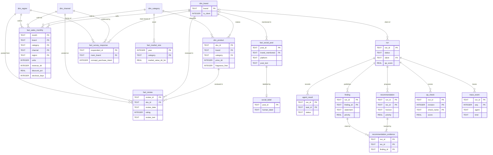

# MarketMind data contracts

MarketMind's agents only cooperate safely because they agree on the shape of everything they exchange. This document describes those contracts at three levels:

1. **Artefact and message schemas**: JSON Schemas for findings, plans, recommendations, QA verdicts, agent results, trace events, run metadata and the sentiment model card.
2. **Dataset row contracts**: JSON Schemas for one row of each clean research dataset.
3. **The relational model**: an SQL schema that holds the clean datasets (a star schema) and the saved runs (an operational store).

All schemas live in [`docs/schemas/`](schemas/). They use JSON Schema Draft 2020-12, and each one has an `$id` under `https://marketmind.local/schemas/`. `tests/test_schemas.py` checks every contract against real system output, so a code change that breaks a contract fails the test suite. Column-level meanings for the datasets are in [DATA_DICTIONARY.md](DATA_DICTIONARY.md).

---

## 1. Schema files

| Schema | Describes | Produced by | Found in a saved run |
|---|---|---|---|
| [`finding.schema.json`](schemas/finding.schema.json) | A finding, the unit of knowledge | Analysis agents | `findings.json` (array) |
| [`research_plan.schema.json`](schemas/research_plan.schema.json) | The research plan | Research Director | `json/plan.json`, `run_meta.json` → `plan` |
| [`recommendation.schema.json`](schemas/recommendation.schema.json) | One prioritised recommendation | Strategy | `json/strategy.recommendations.json` (array) |
| [`qa_result.schema.json`](schemas/qa_result.schema.json) | The Critic's verdict, checks and issues | Critic | `json/qa.result.json` |
| [`agent_result.schema.json`](schemas/agent_result.schema.json) | The outcome of one agent execution | Every agent | `run_meta.json` → `agents` |
| [`trace_event.schema.json`](schemas/trace_event.schema.json) | One traced event | Every agent, the system | `trace.jsonl` (one per line) |
| [`run_meta.schema.json`](schemas/run_meta.schema.json) | Run metadata: brief, plan, timings, LLM usage, workflow, QA, messages | `MarketResearchSystem` | `run_meta.json` |
| [`sentiment_model_card.schema.json`](schemas/sentiment_model_card.schema.json) | Metrics, selection and training history of the sentiment model | Consumer Insight | `json/consumer.model_card.json` |
| [`datasets/sales_panel_row.schema.json`](schemas/datasets/sales_panel_row.schema.json) | One clean sales-panel row | Data Quality | (not saved per run) |
| [`datasets/review_row.schema.json`](schemas/datasets/review_row.schema.json) | One clean review | Data Quality | |
| [`datasets/social_post_row.schema.json`](schemas/datasets/social_post_row.schema.json) | One clean social post | Data Quality | |
| [`datasets/survey_response_row.schema.json`](schemas/datasets/survey_response_row.schema.json) | One screened survey response | Data Quality | |
| [`datasets/product_row.schema.json`](schemas/datasets/product_row.schema.json) | One catalogue SKU | Data Quality | |
| [`datasets/market_size_row.schema.json`](schemas/datasets/market_size_row.schema.json) | One market-size estimate | Data Quality | |
| [`datasets/social_label_row.schema.json`](schemas/datasets/social_label_row.schema.json) | One hand-labelled social post | Data Quality (passed through) | |
| [`database.sql`](schemas/database.sql) | The relational model (SQLite dialect) | `scripts/export_sqlite.py` | `outputs/marketmind.db` |

`run_meta.schema.json` refers to `research_plan.schema.json` and `agent_result.schema.json` by their absolute `$id`s. Validators must therefore load all the schemas into one registry (see section 6).

## 2. Blackboard key registry

Every artefact on the blackboard has one producer. The run store saves each artefact by its type: DataFrames go to `tables/`, dicts of DataFrames to `tables/<key>.<name>.csv`, other objects to `json/`, and the report to `report.md` and `report.html`. The keys that start with `datasets` are not saved, because they are rebuilt from `data/raw`.

| Key | Type | Producer | Main consumers | Saved as |
|---|---|---|---|---|
| `plan` | dict, ResearchPlan | Research Director | every agent | `json/plan.json` |
| `datasets.raw` | dict of 7 DataFrames | Data Collection | Data Quality | not saved |
| `data.catalog` | DataFrame | Data Collection | Report Writer, dashboard | `tables/data.catalog.csv` |
| `external.macro` | DataFrame | Data Collection | Market & Trend Analyst | `tables/external.macro.csv` |
| `external.news` | DataFrame | Data Collection | dashboard | `tables/external.news.csv` |
| `datasets` | dict of 7 DataFrames (clean) | Data Quality | analysis agents, Strategy | not saved |
| `dq.report` | dict | Data Quality | dashboard | `json/dq.report.json` |
| `dq.scorecard` | DataFrame | Data Quality | Report Writer | `tables/dq.scorecard.csv` |
| `dq.caveats` | list of strings | Data Quality | Report Writer | `json/dq.caveats.json` |
| `market.tables` | dict of 12 DataFrames | Market & Trend Analyst | Strategy, Report Writer, dashboard | `tables/market.tables.*.csv` |
| `competition.tables` | dict of 10 DataFrames | Competitive Intelligence | Strategy, Report Writer, dashboard | `tables/competition.tables.*.csv` |
| `consumer.tables` | dict of 15 DataFrames | Consumer Insight | Strategy, Report Writer, dashboard | `tables/consumer.tables.*.csv` |
| `consumer.model_card` | dict, SentimentModelCard | Consumer Insight | Report Writer, Critic, dashboard | `json/consumer.model_card.json` |
| `segmentation.tables` | dict of 8 DataFrames | Segmentation | Strategy, Report Writer, dashboard | `tables/segmentation.tables.*.csv` |
| `segmentation.model_card` | dict | Segmentation | Report Writer, Critic | `json/segmentation.model_card.json` |
| `forecast.tables` | dict of 14 DataFrames | Demand Forecasting | Strategy, Report Writer, dashboard | `tables/forecast.tables.*.csv` |
| `forecast.model_card` | dict | Demand Forecasting | Report Writer, Critic | `json/forecast.model_card.json` |
| `strategy.swot` | dict of 4 lists | Strategy | Report Writer, Critic | `json/strategy.swot.json` |
| `strategy.opportunities` | DataFrame | Strategy | Report Writer, Critic | `tables/strategy.opportunities.csv` |
| `strategy.recommendations` | list of Recommendation | Strategy | Report Writer, Critic, Analyst Chat | `json/strategy.recommendations.json` |
| `strategy.kpis` | dict | Strategy | Report Writer, Critic, dashboard | `json/strategy.kpis.json` |
| `strategy.exec_summary` | string | Strategy | Report Writer, Critic | `json/strategy.exec_summary.json` |
| `strategy.exec_summary_llm` | string (only with an LLM) | Strategy | Report Writer | `json/strategy.exec_summary_llm.json` |
| `report.commentary` | dict, section to text | Report Writer | Report Writer (revisions) | `json/report.commentary.json` |
| `report.sections` | list | Report Writer | dashboard | `json/report.sections.json` |
| `report.markdown` | string | Report Writer; the system appends the QA certificate | Critic | `report.md` |
| `report.html` | string | Report Writer; the system adds the QA certificate and badge | readers | `report.html` |
| `qa.result` | dict, QAResult | Critic | Research Director, system | `json/qa.result.json` |
| `qa.history` | list | Critic | system, dashboard | `json/qa.history.json` |

Findings are not stored under a key. They have their own list on the blackboard (`add_finding` and `findings()`) and are saved to `findings.json`. Messages go into `run_meta.json` → `messages`, and the trace into `trace.jsonl`.

## 3. Artefact contracts

### Finding

| Field | Type | Rule |
|---|---|---|
| `id` | string | Pattern `^[A-Z]{2,4}-[0-9]{2}$`: an area prefix plus two digits (DAT, MAC, MKT, CMP, CON, SEG, FCT) |
| `agent` | string | Name of the agent that published it |
| `area` | enum | `data`, `market`, `competition`, `consumer`, `segmentation`, `pricing`, `forecast`, `strategy` |
| `title` | string | 1-120 characters |
| `statement` | string | At least 10 characters; one sentence containing the supporting numbers |
| `metrics` | object | Values that are numbers, strings, booleans or null. The Critic treats them as evidence numbers. |
| `evidence` | string[] | The datasets, methods or artefacts it was derived from |
| `impact` | integer | 1 (minor) to 5 (critical) |
| `confidence` | number | 0 to 1 |
| `swot` | `S`, `W`, `O`, `T` or null | Quadrant from the client's point of view; null for methodology findings |
| `tags` | string[] | Topic tags, used by the SWOT, the playbook and chat retrieval |
| `priority` | number | Derived: impact x confidence (present in saved runs) |

No other properties are allowed (`additionalProperties: false`). An example from the reference run:

```json
{
  "id": "CMP-02",
  "agent": "Competitive Intelligence Agent",
  "area": "competition",
  "title": "Under-indexed on TikTok Shop",
  "statement": "Kirana Beauty is under-indexed on TikTok Shop, the fastest-growing channel (+28.5%): it generates 11.2% of Kirana Beauty's sales versus 28.1% for the market (index 0.40).",
  "metrics": {"channel": "TikTok Shop", "index": 0.4, "client_mix": 0.1122, "market_mix": 0.2806, "channel_growth": 0.2852},
  "evidence": ["market_sales_panel.csv"],
  "impact": 5, "confidence": 0.9, "swot": "W", "tags": ["channel", "gap"], "priority": 4.5
}
```

### Recommendation

| Field | Type | Rule |
|---|---|---|
| `id` | string | `R1`, `R2`, ... in order of priority |
| `title`, `action`, `rationale`, `kpi`, `owner` | string | Non-empty |
| `evidence` | string[] | Finding IDs; at least one, each matching the finding ID pattern |
| `timeline` | string | For example `0-3 months` |
| `horizon` | enum | `Quick win`, `Core move`, `Strategic bet` |
| `effort` | enum | `Low`, `Medium`, `High` |
| `value_idr` | number or null | Sized opportunity value in rupiah, if any |
| `impact`, `confidence`, `priority` | numbers | Priority = impact x confidence x effort factor (Low 1.0, Medium 0.85, High 0.7) |

```json
{
  "id": "R1", "title": "Fix the packaging issue and win back trust",
  "action": "Run a root-cause review with the supplier, replace affected units proactively, ...",
  "rationale": "Packaging complaints spiked to 31.0 per 100 reviews (2026-02 to 2026-04) versus a 3.9 baseline.",
  "evidence": ["CON-03", "CON-09"],
  "kpi": "Packaging complaints back below 5.8 per 100 reviews within 3 months",
  "timeline": "0-3 months", "horizon": "Quick win", "owner": "Operations & Quality", "effort": "Low",
  "value_idr": null, "impact": 5, "confidence": 0.77, "priority": 3.87
}
```

### ResearchPlan

The plan holds `brief`, `client`, `competitors`, `categories`, `channels`, `horizon_months` (3-12), `data_window` (first and last month), `modules` (a boolean for each of `market`, `competition`, `consumer`, `segmentation`, `pricing`, `forecast`), `concept` (string or null), `objectives`, `questions` (`{id: "Q1", area, question}`), `planner` (`rule-based`, or `rule-based + LLM refinement`) and `created`.

### QAResult

| Field | Meaning |
|---|---|
| `score` | 0-100, the weighted sum of the six checks |
| `passed` | `score >= 85` and no critical issue |
| `revision` | 0 for the first pass, then 1 and 2 |
| `numbers_checked`, `numbers_grounded` | Counts from the numeric-grounding check (412 of 412 in the reference run) |
| `checks` | An object for each of `structure`, `coverage`, `grounding`, `citations`, `recommendations` and `disclosure`. Each has a `score` from 0 to 1 plus details for that check. |
| `issues` | A list of `{check, severity, block, message}`, where `severity` is `critical`, `major` or `minor`, and `block` names the LLM block to replace or is `null` |

An illustrative failing issue, of the kind produced by the Critic test (`tests/test_system.py`):

```json
{"check": "grounding", "severity": "critical", "block": "exec_summary",
 "message": "1 number(s) in 'exec_summary' not found in the evidence: 999 ('...triple to Rp 999 trillion next year...')"}
```

### AgentResult, TraceEvent, RunMeta and SentimentModelCard

- **AgentResult**: `agent`, `status` (`completed`, `failed` or `skipped`), `summary`, `seconds`, `findings`, `tool_calls`, `llm_calls`, `error` (null unless the agent failed).
- **TraceEvent**: `ts` (Unix seconds), `time` (`HH:MM:SS`), `agent`, `kind`, `message`, `data` (free-form object). `kind` is one of `status`, `thought`, `action`, `observation`, `finding`, `message`, `llm`, `warning` or `error`. For example:
  `{"ts": 1793778362.57, "time": "14:46:02", "agent": "Data Quality Agent", "kind": "action", "message": "clean_sales_panel - standardise labels, ...", "data": {"tool": "clean_sales_panel"}}`
- **RunMeta**: `run_id`, `status` (`completed` or `failed`), `started`, `seconds`, `brief`, `client`, `plan` (ResearchPlan), `options`, `llm` (provider, model, description, stats, last error), `agents` (task id to AgentResult, including `report_rev1` and so on), `agent_roster`, `workflow` (layers, edges, tasks), `qa` (score, passed, revisions, history) and `messages`.
- **SentimentModelCard**: the task and labels, the label source, split sizes, class distribution, validation macro-F1 per candidate, test metrics per candidate, `selected`, `ensemble_weight`, the confusion matrix, training seconds, BiGRU history and configuration, vocabulary size, `trained_at`, plus optional `data_hash`, `transfer_model`, `transfer_n` and `transfer_metrics`. Four optional fields describe the training data option: `training_data` (mode, number of study and real reviews, source, cache folder), `split_sources` (rows per source in each split), `test_metrics_by_source`, and `study_reviews_check` (the score on all the study's reviews when the model was trained on real reviews only). RunMeta's `options` records the mode as `sentiment_data`.

## 4. Dataset row contracts

The seven row schemas describe the **clean** datasets, that is, what the Data Quality agent guarantees to downstream agents. They enforce types, enumerations (categories, channels, regions, platforms, labels), ranges (ratings 1-5, ages, percentages, non-negative counts) and formats (ISO dates, id patterns such as `SKU-NNN`, `RNNNNNN`, `PNNNNNN` and `SNNNNN`). The **raw** sales file deliberately violates its contract (duplicates, stray spaces in channel names, non-positive units, outliers, missing discounts), so that the Data Quality agent has something real to fix; `test_raw_sales_violates_the_contract` checks that the defects are still present.

| Contract | Key | Notable rules |
|---|---|---|
| SalesPanelRow | month + brand + category + channel + region | `month` is the first of a month (`YYYY-MM-01`); 5 categories, 5 channels, 7 regions; units and revenue non-negative; prices positive; `discount_pct` from 0 to 1; `promo_flag` boolean; `stockout_days` 0-31 |
| ReviewRow | `review_id` | Online channels only (no Offline Retail); `rating` 1-5; `review_text` null for rating-only reviews; skin type from a fixed list or null |
| SocialPostRow | `post_id` | Platform is TikTok, Instagram, X or YouTube; `brand_mentioned` is an empty string for generic topic posts; `topics` is a `;`-separated list; engagement counts non-negative |
| SurveyResponseRow | `respondent_id` | Ages 15-75; importance, satisfaction, trust and purchase intent on 1-5 scales; NPS 0-10; four Van Westendorp prices of at least Rp 5,000; `aware_<brand>` flags 0/1; `attention_check` always 4 after screening |
| ProductRow | `sku_id` | `fragrance_free`, `halal_certified`, `bpom_registered` booleans; `spf` 15-100 or null; price and size positive |
| MarketSizeRow | year + category | `status` is `actual` or `estimate`; shares 0-100; market value positive |
| SocialLabelRow | `post_id` | `human_label` is `negative`, `neutral` or `positive` |

## 5. Relational model

[`database.sql`](schemas/database.sql) is written in the SQLite dialect and moves to PostgreSQL with small type changes. It has two parts.

- **Part A, analytical store.** A star schema with natural keys, so that the CSV values load as they are. It has dimensions for brand, category, channel, region and product, facts for monthly sales, reviews, social posts, survey responses and market size, the `social_label` table, and a `v_brand_share_monthly` view.
- **Part B, operational store.** One set of rows per saved run: the run itself, agent results, findings, recommendations and the evidence links between them, QA check scores and trace events. It serves audit trails and reporting across runs.

`CHECK` constraints mirror the JSON Schemas (enums, ranges, booleans stored as 0/1), and foreign keys are enforced when the connection runs `PRAGMA foreign_keys = ON`.



The diagram shows key columns only; `database.sql` has them all.

### Building the database

```bash
python scripts/export_sqlite.py
```

This rebuilds `outputs/marketmind.db` from scratch: it creates the schema, runs the Data Quality agent on `data/raw`, loads the clean datasets and the latest run, and reports the row counts and any foreign-key violations (it exits with a non-zero code if there are any). Options: `--run <run_id>` for a specific run, `--all-runs` for every saved run, and `--db <path>` for another file. The same functions are available from Python in `marketmind/sql_export.py` (`connect`, `create_schema`, `clean_datasets`, `load_datasets`, `load_run`).

Row counts for the bundled data and the reference run: 48,280 sales rows, 20,106 reviews, 10,958 social posts, 400 social labels, 2,215 survey responses, 49 products and 40 market-size rows. The run adds 11 agent results, 37 findings, 8 recommendations, 21 evidence links, 6 QA checks and 173 trace events, with 0 foreign-key violations.

### Example queries

```sql
-- The client's monthly value share of the tracked panel
SELECT month, ROUND(100 * value_share, 1) AS share_pct
FROM v_brand_share_monthly
WHERE brand = (SELECT brand FROM dim_brand WHERE is_client = 1)
ORDER BY month;

-- Each recommendation of the latest run with the findings behind it
SELECT r.rec_id, r.title, f.finding_id, f.statement
FROM recommendation r
JOIN recommendation_evidence e ON e.run_id = r.run_id AND e.rec_id = r.rec_id
JOIN finding f ON f.run_id = e.run_id AND f.finding_id = e.finding_id
WHERE r.run_id = (SELECT MAX(run_id) FROM run)
ORDER BY r.priority DESC;

-- Average rating by brand per quarter
SELECT brand, SUBSTR(review_date, 1, 4) || '-Q' || ((CAST(SUBSTR(review_date, 6, 2) AS INTEGER) + 2) / 3) AS quarter,
       ROUND(AVG(rating), 2) AS avg_rating, COUNT(*) AS reviews
FROM fact_review
GROUP BY brand, quarter
ORDER BY brand, quarter;

-- How long each agent took, across all loaded runs
SELECT agent, COUNT(*) AS runs, ROUND(AVG(seconds), 1) AS avg_seconds, SUM(status <> 'completed') AS failures
FROM agent_result
GROUP BY agent
ORDER BY avg_seconds DESC;
```

## 6. Validating against the contracts

From Python:

```python
import json
from pathlib import Path
from jsonschema import Draft202012Validator
from referencing import Registry, Resource

schemas = [json.loads(p.read_text(encoding="utf-8")) for p in Path("docs/schemas").rglob("*.schema.json")]
registry = Registry().with_resources([(s["$id"], Resource.from_contents(s)) for s in schemas])
finding_schema = next(s for s in schemas if s["title"] == "Finding")
validator = Draft202012Validator(finding_schema, registry=registry)

run = Path("outputs/runs") / "20261104-144556"          # any saved run
for finding in json.loads((run / "findings.json").read_text(encoding="utf-8")):
    for error in validator.iter_errors(finding):
        print(finding["id"], error.message)
```

From the test suite:

```bash
python -m pytest -q tests/test_schemas.py
```

| Test | What it proves |
|---|---|
| `test_every_schema_is_valid` | Every schema file is itself valid Draft 2020-12 |
| `test_run_outputs_match_schemas` | A fresh offline run's findings, plan, QA verdict, model card, run metadata, recommendations and every trace event conform |
| `test_clean_datasets_match_row_contracts` | 400 sampled rows of each clean dataset conform to their row contract |
| `test_raw_sales_violates_the_contract` | The raw sales file still carries its planted defects |
| `test_sql_model_loads_data_and_run` | The SQL model loads the clean data and a run with no foreign-key problems, and the latest month's brand shares sum to 1 |

## 7. Changing a contract

1. Change the producer's code and the schema in the same change. Keep `additionalProperties: false` on Finding, so that a misspelt field fails loudly.
2. If the change affects storage, update `database.sql` and the loader in `marketmind/sql_export.py`.
3. Run `python -m pytest -q`. The schema tests run the whole pipeline once, offline, and validate its output.
4. Update this document and [DATA_DICTIONARY.md](DATA_DICTIONARY.md).
